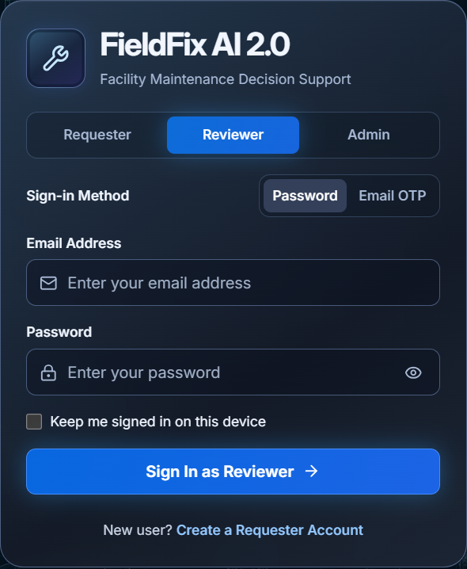

# FieldFix AI 2.0

**Human-in-the-Loop Facility Maintenance Triage & Work-Order System**

Facility complaints often arrive as short descriptions and photos with inconsistent detail. FieldFix gives requesters one place to report and track a problem, gives reviewers the evidence to make and explain a decision, and gives administrators tools to manage the teams and categories that handle the work.

## System architecture

| Layer | Technology and responsibility |
| --- | --- |
| Web | React, React Router, Vite and Chart.js power the three role portals. The development server proxies same-origin `/api` requests to FastAPI. |
| API and access control | FastAPI enforces role-based access control using short-lived JWT access tokens and each account’s current role and active status. Passwords use Argon2id. Remembered sessions use a rotating HttpOnly cookie on the auth routes, with origin and CSRF checks. |
| Data and evidence | SQLModel and Alembic manage the SQLite schema. Request photos and optional proof of completion are stored separately from the frontend and served through authorized API routes. |
| AI | Separate local inference workers load the frozen scikit-learn NLP pipeline and PyTorch ResNet-18 model. Versioned priority rules run in the API. The Reviewer makes the final decision. |

## Three-role workflow

| Role | What the role does |
| --- | --- |
| **Requester** | Submit a complaint with location, description and optional photos. Track its status and view the outcome and authorized proof of completion. |
| **Reviewer** | Open **Triage & Resolution** to view complaints and saved AI analysis status. Select the final category, priority and team. Approve, reject, or request more information. Approval records the decision and creates one work order in a single transaction. After the work is done, record resolution notes, confirm completion, and attach optional proof. **History** preserves the review decision and resolution. |
| **Administrator** | Manage accounts, roles, maintenance categories, teams and the requester registration setting. View team workload and **System Performance & Overrides**, including comparisons between saved suggestions and human decisions where available. |

## AI modules and limitations

All outputs are advisory. The Reviewer confirms the category, priority and team and submits the decision. Manual review remains available when an AI feature is disabled or unavailable.

| Module | What to demonstrate and explain |
| --- | --- |
| **NLP** | The frozen TF-IDF + LinearSVC pilot covers **Plumbing, Electrical and HVAC**. Inspect a saved complaint in **AI Analytics (CV & NLP)** or run the NLP demo during review. Scope rules, label agreement and the model margin can produce an abstention. The margin is uncalibrated, and reliable out-of-scope detection has yet to be established. Live assignment suggestions remain gated by validation and approved category bindings. |
| **Computer Vision** | **ResNet-18** screens a still JPEG only after the Reviewer confirms that it is a concrete close-up. It receives normalized 224 × 224 RGB and uses a frozen crack-class threshold of **0.86**. The image-quality gate requires a valid supported image. Blur, exposure and resolution warnings help the Reviewer assess suitability. Grad-CAM highlights areas influencing the crack score. The METU evaluation is provisional because parent-photo independence is unverified. Screening cannot establish structural safety. |
| **Priority rules** | Deterministic rules suggest High for explicit hazards such as active flooding or electrical sparking, Medium for clear loss of service, and Low for explicitly cosmetic issues without functional impact. They show the matched evidence and abstain when timing, impact or urgency is unclear. |

Triage badges reflect saved evaluations for the complaint. Pasted NLP demo text is independent of the queue. Dashboard sample charts are summaries. Agreement with a human decision, abstention rates and screening coverage are operational measures, separate from held-out model performance.

## Local setup and run

The verified setup uses Windows PowerShell, Python 3.12 and Node.js 26. From the project root, install the dependencies for a fresh checkout. Reuse the existing environments on a prepared demo machine.

```powershell
py -3.12 -m venv backend\.venv
& .\backend\.venv\Scripts\python.exe -m pip install -r backend\requirements.txt
npm.cmd --prefix frontend ci
```

For an existing installation, stop the backend and back up `backend/fieldfix.db` and `backend/uploads/` before applying migrations. From the project root, initialize or upgrade the local database and check its revision.

```powershell
& .\backend\.venv\Scripts\python.exe -m alembic -c .\backend\alembic.ini upgrade head
& .\backend\.venv\Scripts\python.exe -m alembic -c .\backend\alembic.ini current
```

Follow the [local role and email setup guide](docs/local-role-and-email-setup.md) to bootstrap the first Administrator, assign a Reviewer, and configure optional SMTP. Set up an active category and team using the [maintenance catalog guide](docs/admin-review-demo.md) before your first approval. Email OTP requires an enrolled mailbox and working SMTP.

**Terminal 1 · FastAPI on port 8000**. From the project root, open the backend directory. For a fresh development checkout, generate a temporary signing key in this terminal; it is not saved and will invalidate local tokens when the backend restarts. For a persistent local key, follow the [Windows DPAPI key setup](backend/README.md#password-authentication). Production deployments must supply a persistent secret through their secret manager.

```powershell
Set-Location backend
$env:FIELDFIX_JWT_SECRET = (& .\.venv\Scripts\python.exe -B -c "import secrets; print(secrets.token_urlsafe(32))")
$env:FIELDFIX_AUTH_ORIGIN = 'http://127.0.0.1:5173'
$env:FIELDFIX_AUTH_LOOPBACK = '1'
& .\.venv\Scripts\python.exe -B -m uvicorn main:app --host 127.0.0.1 --port 8000
```

On the prepared demo machine, the private `%LOCALAPPDATA%\FieldFixAI\auth\Start-DemoBackend.ps1` launcher loads the signing key and enables optional AI features. The [worker guide](ml/inference/README.md) documents the separate frozen runtime environments and artifacts under `%LOCALAPPDATA%\FieldFixAI\ml`. The AI flags default to disabled. For the demo, set `FIELDFIX_AI_NLP_DEMO_ENABLED`, `FIELDFIX_AI_CV_ENABLED` and `FIELDFIX_AI_PRIORITY_ENABLED` to `1` in the API process and leave `FIELDFIX_AI_NLP_ENABLED` disabled.

**Terminal 2 · Vite on port 5173**. From the project root, start Vite on loopback.

```powershell
Set-Location frontend
npm.cmd run dev -- --host 127.0.0.1 --port 5173 --strictPort
```

Open the [application login](http://127.0.0.1:5173/login) or [FastAPI documentation](http://127.0.0.1:8000/docs).

## Testing and viva

From the project root, run the backend suite, which uses disposable databases and uploads, and build the frontend.

```powershell
& .\backend\.venv\Scripts\python.exe -m pip install pytest
Push-Location backend
& .\.venv\Scripts\python.exe -B -m pytest -q
Pop-Location
npm.cmd --prefix frontend run build
```

Set `FIELDFIX_TEST_FROZEN_MODELS=1` before pytest on a machine with both frozen runtimes and the existing sample image to include the optional real-model integration check. The check exercises loading and inference without rerunning either held-out evaluation.

For the viva, demonstrate submission, evidence review, approval, work-order resolution and history with disposable records. Include an in-scope NLP example and an abstention, a concrete close-up with Grad-CAM and its quality checks, and a Reviewer decision that explains how the evidence was used. [Demo and viva guide](docs/milestone-14-demo-and-viva.md)

## Repository layout

```text
backend/
  app/                 FastAPI routes, authentication, rules, and services
  migrations/          Alembic schema migrations
  tests/               Backend integration and behavior tests
frontend/
  src/                 React role portals, forms, and API clients
  package.json         Frontend scripts and dependencies
ml/
  inference/           Bounded local model workers and their protocol
  nlp/                 FMUCD text preprocessing and training
  pilot/               Dataset acquisition and label-audit utilities
  cv/                  METU acquisition, preparation, audit, and training
docs/                  Setup, demo, and evaluation notes
```

Live SQLite data, uploads, environment secrets, raw datasets, generated builds, Python/Node caches, and model checkpoints are local-only and excluded from Git.

## Environment variables

Set variables in the backend process environment. Do not commit a populated `.env` file or paste credentials into source code.

| Variable | Purpose |
| --- | --- |
| `FIELDFIX_JWT_SECRET` | Required signing key; use at least 32 cryptographically random bytes encoded as unpadded base64url. Use a persistent secret manager outside local development. |
| `FIELDFIX_AUTH_ORIGIN` | Trusted browser origin, normally `http://127.0.0.1:5173` for local development. |
| `FIELDFIX_AUTH_LOOPBACK` | Set to `1` only for the loopback development setup described above. |
| `FIELDFIX_SMTP_HOST`, `FIELDFIX_SMTP_PORT`, `FIELDFIX_SMTP_FROM`, `FIELDFIX_SMTP_USER`, `FIELDFIX_SMTP_PASSWORD` | Optional email OTP delivery. The port defaults to 465; provide real values only in the private backend process environment. |
| `FIELDFIX_AI_NLP_DEMO_ENABLED` | Enables the research-only NLP demo when its frozen NLP runtime is available. |
| `FIELDFIX_AI_CV_ENABLED` | Enables concrete-photo screening only when its frozen CUDA runtime and model files are available. |
| `FIELDFIX_AI_PRIORITY_ENABLED` | Enables the deterministic priority recommendation rules. |
| `FIELDFIX_AI_NLP_ENABLED` | Live NLP category suggestions are still blocked by a code-level rollout gate; setting this flag does not enable them. |

## Frozen model setup and reproducibility

Raw training datasets and model files are not stored in this repository. A fresh clone does **not** contain the frozen inference artifacts, and the optional model workers remain unavailable until the exact verified files and compatible runtimes are provisioned. Priority recommendations do not require a trained model.

The workers use these pinned artifacts under the current Windows user's `%LOCALAPPDATA%\FieldFixAI\ml` directory; this location is created per machine and is not included in the repository:

| Worker | Required model file | Expected SHA-256 | Runtime |
| --- | --- | --- | --- |
| NLP | `runs\nlp\milestone-11-v1\linear_svc.joblib` (38,506 bytes) | `8c7835a9c065a4a672d9ed8639a962fb5a716a7054d2d84ce4d28731c8eae522` | Python 3.12.10; versions in `ml/nlp/requirements-m11.txt` |
| CV | `runs\cv\metu-resnet18-m12-v1\resnet18-inference.pt` (44,787,275 bytes) | `f98d6d635a260cbdfbdc9f23b2ac718fd074be93db2e1666023e75cceb94f027` | Python 3.12; CUDA 12.6; versions in `ml/cv/milestone12/requirements.txt` |

The API workers validate model hashes and frozen metadata before loading. The CV worker also requires a CUDA-capable runtime. There is currently no public model-binary download URL. The combined trained checkpoints do not have a separately documented release license, and redistribution of their upstream pretrained weights has not been independently cleared; this repository therefore omits them until that review and a trusted release source exist. No Git LFS artifacts are published. Do not copy model files from an untrusted source or enable these features expecting a clone to have them.

To reproduce the research pipelines from their cited sources, use the dataset-specific instructions before running training:

1. For NLP, install the pinned environment from `ml/nlp/requirements-m11.txt`, then follow [FMUCD acquisition and validation](ml/pilot/README.md) and [NLP training/evaluation](ml/nlp/README.md). The acquisition utility retains bounded source ranges rather than the full CSV.
2. For CV, read [METU acquisition and preparation](ml/cv/README.md) first. Run the preflight, then explicitly approve the approximately 230 MiB dataset download before preparing it. The training recipe requires a CUDA 12.6 environment and a verified pre-training backup receipt; see [Milestone 12](ml/cv/milestone12/README.md).
3. Treat each regenerated model as a new research run. The deployed workers accept only the exact frozen hashes and metadata above; newly trained weights are not automatically approved for application inference. A future model release must document provenance, dataset attribution, evaluation, and hashes before distribution or rollout.

The public NLP result is 60/67 on a single-university held-out test (89.55% accuracy, 0.8843 macro-F1). The CV result is 99.8689% accuracy on a provisional patch split, with five false negatives and zero false positives; source-photo independence is unverified. These small or potentially related evaluation sets do not establish deployment performance. CV screening is not a structural-safety assessment.

## Application screenshot

The login screen below contains no private account or request data.



## Dataset and model acknowledgements

- Pampana et al., **Facility Management Unified Classification Database v1**, Mendeley Data, DOI [10.17632/cb8d2nsjss.1](https://data.mendeley.com/datasets/cb8d2nsjss/1), licensed CC BY 4.0. It informed the three-class NLP pilot.
- Özgenel, **Concrete Crack Images for Classification v2**, Mendeley Data, DOI [10.17632/5y9wdsg2zt.2](https://data.mendeley.com/datasets/5y9wdsg2zt/2), licensed CC BY 4.0. It informed the provisional CV pilot.
- The CV training procedure initializes ResNet18 from the torchvision ImageNet-1K weights. See the [torchvision ResNet18 documentation](https://pytorch.org/vision/stable/models/generated/torchvision.models.resnet18.html) and comply with upstream terms.

Dataset archives and trained model binaries are intentionally not redistributed here. The dataset-specific guides include acquisition details, attribution, checksums, and limitations.

## Future scope

Planned work includes requester replies, fuller work-order progression, representative NLP scope validation and approved category bindings, source-photo-independent CV evaluation, and production hardening for HTTPS, account recovery, abuse controls, backups, and monitoring.
